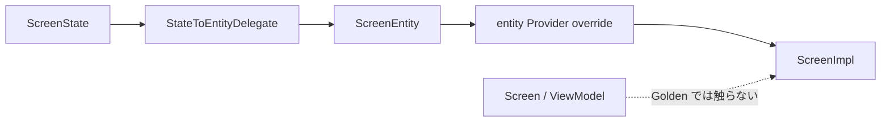

# Flutter Layered Architecture / Golden Test 設計

Golden Test は **表示状態ごとの見た目回帰**を検出し、MVVM では **State→Entity 変換と UI マッピングの整合**も同時に担保する。
画面実装では実施を推奨する。**MVVM で組んだ Screen では必須**とする。

本 SKILL は **設計・ファイルレイアウト・ハーネスの参考実装提供**が最低成果物である。
プロンプトが実装まで求めるなら、同じ設計に沿って `testing_golden` 相当・画面 Golden まで書く。

## アセットディレクトリ

* `./assets/`
* `apm_modules/**/flutter_layered_architecture/.apm/skills/flutter-layered-architecture-design-golden-test/assets/`

## スコープ外（別正本）

| 関心 | 正本 |
| --- | --- |
| Screen / ScreenImpl・watch/read・本番 MVVM 構造 | `flutter-layered-architecture-design-screen-mvvm` |
| ViewModel Unit Test・Delegate 単体 | `design-screen-mvvm` の testing / `design-test` |
| `testing_core` / `testing_injection` / Mock 可否 | `flutter-layered-architecture-design-test` |
| Provider / injection 結線形 | `flutter-layered-architecture-design-dependency-injection` |
| package 所属レイヤー | `flutter-layered-architecture-resolve-package-layer` |
| Dart コーディング規約 | `flutter-layered-architecture-coding-rules` |

## いつ使うか

* Screen（特に MVVM）の見た目回帰・Golden 追加・更新・失敗調査
* `testing_golden`（または同等）ハーネスの新設・改修
* State→Entity→View の Golden 組み立て、状態網羅の設計
* View コンポーネント単体の見た目比較でも同じ基盤を使うとき

## 検証する / しない

検証する:

1. **表示状態と見た目** — 状態ごとに UI が意図どおり描画されること
2. **State→Entity→View（MVVM）** — 本番と同じ `StateToEntityDelegate` 経由で Entity を作り、その結果が View に反映されること

検証しない（別手段へ）:

* 操作後の状態遷移 → Widget Test / 統合テスト
* 非同期・API の成否 → ViewModel Unit Test（`design-screen-mvvm` / `design-test`）
* ViewModel / Usecase / Repository のロジック → Unit Test（Golden では扱わない）

## 作業手順

1. **成果物の粒度を決める** — 設計メモのみ / ハーネス参考実装の提示 / 画面 Golden まで実装
2. **本番 View が Golden 可能か確認する** — Screen（DI・初期化）と ScreenImpl（Entity・見た目）が分離していること（[mvvm-pattern.md](./references/mvvm-pattern.md)）
3. **共通ハーネスを用意する** — プロジェクトの `testing_golden` 相当（[harness.md](./references/harness.md)、[assets/testing_golden](./assets/testing_golden/)）
4. **ファイルレイアウトを決める** — `test/golden/`・helpers・goldens（[file-layout.md](./references/file-layout.md)）
5. **状態を洗い出す** — sealed State / UI バリエーション（[state-coverage.md](./references/state-coverage.md)）
6. **Golden を書く** — State→Delegate→Entity→`overrideWithBuild`→ScreenImpl（[screen-helpers.md](./references/screen-helpers.md)）

## 全体像（MVVM）

```text
ScreenState（テスト用ファクトリ）
  → StateToEntityDelegate.execute()   … 本番と同じ変換
  → ScreenEntity
  → Providers.entity.overrideWithBuild
  → ScreenImpl（Entity のみ watch）
```



なぜこうするか: Screen は ViewModel の watch・`onInitialize`・Event 購読を担い、ScreenImpl は Entity だけで描画する。
Golden は **Entity Provider を固定注入**すれば ViewModel を起動せずに見た目を検証できる。
**ViewModel の Mock は実装しない**（分離で十分）。

補助として Entity を直接注入する形もあるが、新規は **State + Delegate 経由を優先**し、変換回帰も拾う。

## 推奨ライブラリ

| 用途 | パッケージ |
| --- | --- |
| Golden API | [alchemist](https://pub.dev/packages/alchemist) |
| 共通ハーネス | プロジェクトの `testing_golden`（本 SKILL の [assets](./assets/testing_golden/) を複製・調整） |
| Entity 注入 | `flutter_riverpod`（`ProviderScope` / `overrideWithBuild`） |

## 原則（要約）

* **画面実装では推奨、MVVM では必須** — 表示状態の代表ケースを Golden に載せる
* **ScreenImpl を撮る** — Screen（DI 系）ではなく、Entity・見た目側を対象にする
* **State→Delegate→Entity を既定にする** — Entity 直注入は変換が自明なときのみ
* **ViewModel を Mock しない** — 分離と Provider override で ViewModel から切り離す
* **見た目は Entity を固定注入できる形にする** — 本番の watch/read 規律を崩さない（子は Entity のみ watch、操作はハンドラ内 `read`）
* **ハーネスはプロジェクトごとに調整する** — Theme・フォント・ローカライズ・端末カタログは [assets](./assets/testing_golden/) を起点に差し替える
* **CI golden と platform golden を両方コミットする** — 偽陽性低減と人間可読の両立（[ci-platform-goldens.md](./references/ci-platform-goldens.md)）
* **レイアウト例外は原則失敗** — 外部ライブラリ都合のみ例外クリア（[layout-exceptions.md](./references/layout-exceptions.md)）

## 最低成果物

| 成果 | 内容 |
| --- | --- |
| 設計 | ScreenImpl 対象、State→Entity 経路、状態網羅、CI/platform 方針 |
| ファイルレイアウト | `flutter_test_config` / `test/golden/` / helpers / `goldens/{CI,platform}/` |
| 参考実装 | [assets/](./assets/) または同等の Dart 断片を提示・適用できること |

## 参考実装（assets）

* [testing_golden](./assets/testing_golden/lib/) — 共通ハーネスの最小形（Theme・フォント・ロケールはプロジェクトで差し替え）
* [screen_golden_example](./assets/screen_golden_example/) — MVVM Screen の helpers + `goldenTest` 骨格

プロジェクト固有の Design System Theme・ARB 注入・フォントアセットはコメント箇所を差し替える。

## 他 SKILL との役割分担

| 作業 | 先に読む | 本 SKILL |
| --- | --- | --- |
| Screen / ScreenImpl・Entity watch | `design-screen-mvvm` | Golden 可能な分離の確認と撮影対象 |
| ViewModel / Delegate Unit Test | `design-screen-mvvm` testing / `design-test` | 触らない（見た目だけ） |
| DI が必要なメタデータ読取等 | `design-test` / `design-dependency-injection` | setUp で `injectForTesting` が要る場合のみ併用 |
| alchemist / 推奨ライブラリ案内 | README | 使い方・ハーネス設計 |

## 追加ドキュメント

| 参照 | 使うとき |
| --- | --- |
| [mvvm-pattern.md](./references/mvvm-pattern.md) | State→Delegate→Entity、Screen/Impl、Mock 禁止 |
| [file-layout.md](./references/file-layout.md) | 配置・命名 |
| [harness.md](./references/harness.md) | `testing_golden` API・初期化 |
| [screen-helpers.md](./references/screen-helpers.md) | `buildGoldenScreen` / State ファクトリ |
| [ci-platform-goldens.md](./references/ci-platform-goldens.md) | CI vs platform、diff、アニメ停止 |
| [state-coverage.md](./references/state-coverage.md) | 状態網羅 |
| [layout-exceptions.md](./references/layout-exceptions.md) | Overflow 等の例外クリア |

## ナレッジベース

### DO: MVVM 画面は State + StateToEntityDelegate 経由で Golden する

* 本番と同じ変換を通すことで、見た目とマッピングの両方を回帰検知する

### DO: 見た目は Entity を固定注入できる形にする

* Screen（DI）と ScreenImpl（見た目）を完全分離し、Golden は Impl を撮る
* 子は Entity 全体ではなく `select` / `watchBy` で必要分だけ `watch` する（ScreenEntity をフィールド渡ししない）
* 操作経路の検証で ViewModel を `build` 中に `watch` しすぎない（本番と同じ watch/read 規律）

### DO: 表示上意味のある状態を網羅する

* sealed State の各バリアント、ボタン有効無効、入力境界など（詳細は state-coverage）

### DO NOT: ViewModel を Mock して Golden する

* Screen / ScreenImpl 分離と Entity override で足りる。Mock は故障注入など Unit 側の話（`design-test`）

### DO NOT: Screen（DI・onInitialize・Event）を Golden のルートにする

* 撮るのは ScreenImpl。初期化や副作用は ViewModel Unit Test へ

### DO NOT: プロジェクト固有 Theme / フォント / ARB を本 SKILL 本体に固定する

* 調整点は assets のコメントとプロジェクトの `testing_golden` に閉じる
