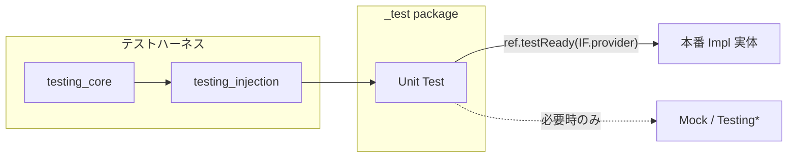

# Flutter Layered Architecture / Unit Test 設計

Unit Test は **TestContext ベースのハーネス**で依存を組み立て、可能な限り **本番 Impl の実体**で検証する。
Mock は「Unit Test では再現できない境界」（認証必須の通信など）や「通信エラー等の故障注入」に限る。

本 SKILL は **ファイルレイアウト・ハーネス設計・参考実装の提供**が最低成果物である。
プロンプトが実装まで求めるなら、同じ設計に沿って package / テストコードまで書く。

## スコープ外（別正本）

| 関心 | 正本 |
| --- | --- |
| Provider / `{layer}_injection` / Container の結線形 | `flutter-layered-architecture-design-dependency-injection` |
| Usecase の切り出し・Request | `flutter-layered-architecture-design-usecase` |
| Repository の窓口・状態 | `flutter-layered-architecture-design-repository` |
| Screen MVVM（ViewModel 内の検証観点） | `flutter-layered-architecture-design-screen-mvvm` |
| Golden の詳細手順・アセット実装 | `flutter-layered-architecture-design-golden-test` |
| package 所属レイヤー | `flutter-layered-architecture-resolve-package-layer` |
| Dart コーディング規約 | `flutter-layered-architecture-coding-rules` |

DI の「どう inject するか」は DI 正本。本 SKILL は **テスト入口でいつ・どこに・何を結線するか** に限定する。

## いつ使うか

* `testing_core` / `testing_injection`（または同等）を新設・改修する
* `_test` package の置き場・依存・入口を設計する
* Usecase / Repository 等のロジックを **実体 DI** で Unit Test する
* 「Mock するか実体か」の判断が必要なとき（mocktail シナリオ、testing_injection を新設しない場合含む）
* Golden で `injectForTesting` が必要なとき（見た目設計自体は `design-golden-test`）
* 既存の薄い testing 記述（各 design SKILL の testing.md）より、ハーネス全体を揃えるとき

## 作業手順

1. **成果物の粒度を決める** — 設計メモのみ / 参考実装の提示 / package・テストまで実装
2. **ファイルレイアウトを決める** — `testing_core`・`testing_injection`・対象の `_test`（[file-layout.md](./references/file-layout.md)）。命名三区分・leaf・ブラックボックスは [naming-and-black-box.md](./references/naming-and-black-box.md)
3. **`testing_core` を用意する** — `TestContext` から `refBuilder` / `ref` を取る拡張（[testing-core.md](./references/testing-core.md)、[assets](./assets/testing_core/)）
4. **`testing_injection` を用意する** — Infra → Data → Usecase を `_test` 向けに一括 `inject`（[testing-injection.md](./references/testing-injection.md)、[assets](./assets/testing_injection/)）
5. **`_test` から実体を読む** — `await testContext.injectForTesting()` のあと `ref.testReady(IF.provider)` 等
6. **Mock が必要かだけ判断する** — [mock-policy.md](./references/mock-policy.md)

## 全体像

```text
testing_core          … TestContext 拡張（testContext / refBuilder / ref / isCI）
testing_injection     … TestContext.injectForTesting()（本番 Impl をテスト用に結線。app に依存しない）
{feature}/_test       … 本番 IF + testing_* に依存。ロジックは実体、境界だけ Testing/Mock
```



なぜこうするか: `_test` が app の本番 `inject()` を import すると実装モジュールへの暗黙参照が広がり、レイヤー境界が崩れる。
テスト専用の結線集約（`testing_injection`）を app 外に置き、**同じ IF `provider` を本番 Impl で bind** することで、依存解決とテスタビリティを両立する。

## 原則（要約）

* **実体優先** — Usecase / Repository 等のロジックは、injection 経由の本番 Impl で検証する
* **Mock は例外** — Unit では再現できない外部（認証必須通信など）、または故障・エラー経路の再現に使う
* **TestContext を入口にする** — コンテナ生成・破棄をテストライフサイクルに載せる（`armyknife_test_context` 等）
* **本番は testing に依存しない** — `_test` / `_testing` / `testing_*` への依存はテスト側だけ
* **app の `inject()` を流用しない** — テスト用結線は `testing_injection` に非正規化してよい（抜けは UnimplementedError で気づく）

## 最低成果物

プロンプトが何を求めても、本 SKILL 適用時は次を欠かさない。

| 成果 | 内容 |
| --- | --- |
| ファイルレイアウト | `testing_core` / `testing_injection` / `_test` の置き場と依存方向 |
| 設計 | `injectForTesting` の層順、実体 vs Mock の境界、IF `provider` の読み方 |
| 参考実装 | [assets/](./assets/) または同等の Dart 断片を提示・適用できること |

実装まで求められた場合は、上記設計に沿って package・テストファイルを追加する。

## 参考実装（assets）

* [testing_core](./assets/testing_core/lib/) — `TestContext` 拡張の最小形
* [testing_injection](./assets/testing_injection/lib/) — `injectForTesting` と part 分割の形
* [_test サンプル](./assets/_test/test/usecase_example_test.dart) — 実体 DI で Usecase を読む形

プロジェクト固有の Logger / Storage / Firebase 等はコメント箇所を差し替える。結線 API は `design-dependency-injection` の `inject` 契約に合わせる。

## 他 SKILL との役割分担

| 作業 | 先に読む | 本 SKILL |
| --- | --- | --- |
| Provider / layer injection の書き方 | `design-dependency-injection` | テスト入口の集約と `_test` 配置 |
| Usecase 追加後の Unit Test | `design-usecase` | 実体 DI で検証するハーネス |
| Repository の Mock / Fake / `_testing` | `design-repository` の testing | いつ実体を残し、いつ Mock にするか |
| ViewModel テストの観点 | `design-screen-mvvm` | `injectForTesting` 後の Container 取得 |
| Golden | `flutter-layered-architecture-design-golden-test` | DI 併用時のみ入口を案内 |

## ナレッジベース

### DO: `testing_core` で `ref` / `refBuilder` を TestContext 管理にする

* テストごとの生成・`disposeAsync` を tearDown に載せる

### DO: `_test` は `injectForTesting` のあと IF `provider` から実体を取る

* `ref.testReady(XxxUsecase.provider)` 等。呼び出し側を実装型に書き換えない

### DO: Infra / 外部境界だけ Testing\* または Mock に差し替える

* 認証・実ネットワーク等が Unit で再現できないときに限る

### DO NOT: ロジック Usecase を常に Mock して組み合わせる

* 実体で検証できるなら Mock しない（テスタビリティのための DI を無駄にしない）

### DO NOT: 本番 package から `testing_*` / `_test` に依存する

* 依存方向はテスト → 本番のみ

### DO NOT: app の本番 `inject()` を `_test` から直接呼ぶことを既定にする

* 実装参照の拡散を避ける。同等バインドを `testing_injection` に持つ
