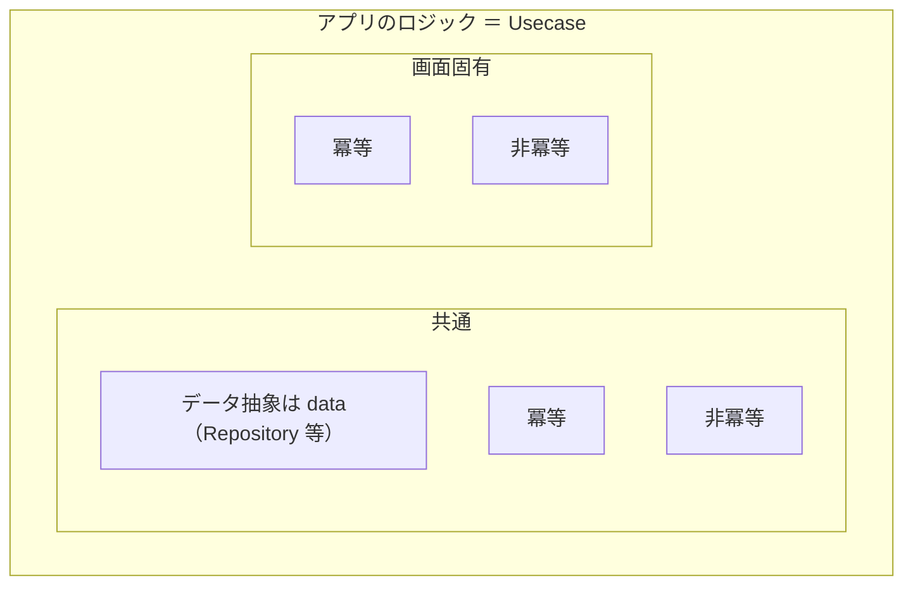

# Flutter Layered Architecture / Usecase 設計

アプリに関わる処理は **Usecase** として切り出す。
メソッド数・シグネチャ・不変性・レイヤー依存は Linter が保証する。
本 SKILL は切り出し判断と、lint が見ない実装パターン（入出力・package 分割・結線・依存・Fake）を扱う。

正本の例: `@flutter_layered_architecture/example/usecase/`。

## スコープ外（別正本）

| 関心 | 正本 |
| --- | --- |
| `@usecase` 付与 | `flutter-layered-architecture-annotations`（`references/usecase.md`） |
| `@injection` / `@implementation` | 同 annotations の各 references |
| public メソッド 1 つ | `flutter-layered-architecture-linter-rule-usecase-single-method` |
| 引数あり・非 void | `flutter-layered-architecture-linter-rule-usecase-method-signature` |
| フィールド final / const コンストラクタ | `flutter-layered-architecture-linter-rule-usecase-immutable` |
| レイヤー依存方向 | `flutter-layered-architecture-linter-rule-architecture-layer-dependency` |
| package 所属レイヤー | `flutter-layered-architecture-resolve-package-layer` |
| Repository パターン | `flutter-layered-architecture-design-patterns` |
| 画面 MVVM | `flutter-layered-architecture-screen-mvvm` |
| workspace / app レイヤー | `flutter-layered-architecture-workspace` |

## いつ使うか

* Usecase の新規作成・分割・命名
* 共通／画面固有、冪等／非冪等の整理
* Request・戻り値、interface / `_impl`、injection 結線
* Usecase → Repository / 他 Usecase の依存、Fake、package internal Usecase

## 作業手順

1. 「アプリの処理」かを確認する（純 UI・純ドメイン値だけなら Usecase にしない）
2. **共通**か **画面固有**か、**冪等**か **非冪等**かを決める
3. 1 操作 = 1 Usecase に切る（構造は lint）
4. `{動詞}{カテゴリ}Usecase` と package 配置を決める
5. `@usecase` を付け、Request／戻り値・IF／`_impl`・injection を整える（詳細は `references/`）

## 考え方: アプリの処理は Usecase



| 区分 | 置くもの | 例 |
| --- | --- | --- |
| 共通・冪等 | 入出力だけで決まる変換・分類 | フォーマット、パース |
| 共通・非冪等 | Repository / API を伴う操作 | 追加・更新・外部送信 |
| 画面固有・冪等 | その画面向けの変換・集約 | 並べ替え・フィルタ |
| 画面固有・非冪等 | 画面起点の副作用付き操作 | リロード、画面エラー共通化 |

* データ Read/Write の窓口は data（Repository 等）。Usecase はそれを組み合わせて「操作」にする
* Usecase 自体はステートレス。状態の保持・監視は Repository / Stateful（`usecase_immutable` と整合）

## 切り出し単位

* 1 Usecase = 呼び出し側から見て **1 つの意図した操作**
* 複数操作・複数の成功条件が混ざるなら分割する
* ViewModel / Delegate で同じ手順が繰り返されるなら共通 Usecase（または package internal）へ
* Delegate 入れ子の代わりに Usecase を切る（`delegate_no_nested_delegate` / `delegate_no_usecase_instantiation`）

## 命名

* 型: `{動詞}{カテゴリ}Usecase`（例: `AddTodoUsecase`、`SearchKanjiUsecase`）
* 実装: `{動詞}{カテゴリ}UsecaseImpl` / Fake は `{動詞}{カテゴリ}UsecaseFake`
* package: `usecase_*` プレフィックス（所属の正本は `resolve-package-layer`）
* メソッド: 新規は原則 `execute`（他名は例外。理由を設計に残す）

## 実装パターン（要約）

* **入出力**: 引数は `*Request` に寄せる（複数入力パターンは sealed）。戻りはドメイン型でも `*Result` でも可（example は `Future<Todo>` 等）
* **package**: IF（`usecase_foo`）と実装（入れ子 `_impl` → `usecase_foo_impl`）を分ける。結線は `@injection`（`usecase_injection`）
* **Provider**: IF 側は `UnimplementedError`、実装側で実体と `dependencies` を書く
* **依存**: 他 Usecase / Repository への依存は可。循環は不可
* **internal**: 画面・Repository `_impl` 内の共通処理は `@internal` Usecase でよい（公開 IF 分離は必須でない）

詳細は必要になったときだけ読む:

| 参照 | 使うとき |
| --- | --- |
| [request-and-return.md](./references/request-and-return.md) | Request / sealed / 戻り値 |
| [package-provider-injection.md](./references/package-provider-injection.md) | IF/_impl、Provider、injection |
| [dependencies-internal-fake.md](./references/dependencies-internal-fake.md) | 依存・循環回避・internal・Fake |

## 最小の形

```dart
@usecase
abstract interface class AddTodoUsecase {
  static final provider = Provider<AddTodoUsecase>(
    (ref) => throw UnimplementedError('AddTodoUsecase is not bound'),
  );

  const AddTodoUsecase();

  Future<Todo> execute(AddTodoRequest request);
}
```

## ナレッジベース

### DO: まず操作単位を決めてから型を切る

* Request 形や実装より先に、呼び出し側の意図が 1 つかを確認する

### DO: IF と実装を package で分ける

* 差し替えと循環防止のため。結線は injection package

### DO: 共通と画面固有を混ぜない

* 画面前提を共通 Usecase に埋め込まない

### DO NOT: Linter が見る構造を本 SKILL に再掲して判断と混ぜる

* メソッド数・シグネチャ・不変性・依存方向は診断側が正本

### DO NOT: Usecase に状態や複数操作を詰め込む

* 状態は Repository / Stateful、複数操作は複数 Usecase

### DO NOT: カテゴリ名詞先行の型名を新規に使う

* `KanjiSearchUsecase` より `SearchKanjiUsecase`（動詞先行）
